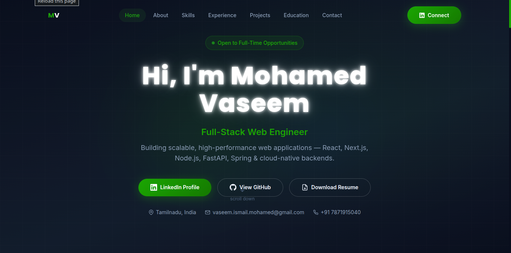

# 🌐 Mohamed Vaseem: Developer Portfolio

A freelance-focused developer portfolio built with Next.js, Tailwind CSS and Framer Motion.

**🔗 Live site:** https://mohamed-vaseem-portfolio.vercel.app/



## ✨ Highlights
- Smooth, animated sections built with Framer Motion
- Responsive layout for all screen sizes
- MongoDB backend with JWT authentication
- Email notifications through Nodemailer
- Organised to present projects and services to freelance clients

## 🧰 Tech Stack
| Layer | Technology |
|---|---|
| Framework | Next.js 15, React 19, TypeScript |
| Styling | Tailwind CSS, Framer Motion |
| Backend | Next.js API routes, MongoDB |
| Auth | JWT, Argon2 / bcrypt |
| Email | Nodemailer |
| Deployment | Vercel |

## 🚀 Run Locally

```bash
git clone https://github.com/mohamedvaseemi/mohamed-vaseem-portfolio.git
cd mohamed-vaseem-portfolio
npm install
cp .env.example .env.local   # fill in your own values
npm run dev
```

Open http://localhost:3000

### Environment variables
```
MONGODB_URI=
JWT_SECRET=
EMAIL_USER=
EMAIL_PASS=
```

## 👤 Author
**Mohamed Vaseem** · Full Stack Developer · [GitHub](https://github.com/mohamedvaseemi)
